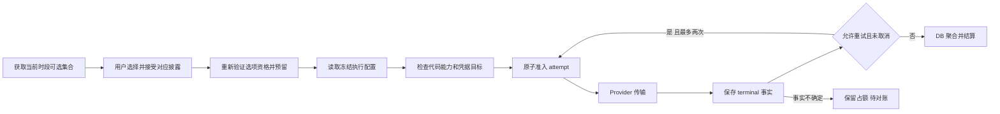

# 数据库重构设计

状态：本地实现与验证完成；进入分批提交、PR/CI 与 Relay 评审阶段，线上切换未执行。日期：2026-11-07。源码评估基线：`ccbeb1a4fc2baba9dbc2c15a4ba183a1be3558aa`。

本次重构从空业务库建立唯一的数据库配置模型，同时切换应用和管理后台，并清理全仓历史兼容与 legacy 实现。prod/test 的旧业务数据、旧数据库接口、旧迁移链、本地旧 JSON 和历史本地文档格式均不迁移；所有入口只支持最新契约和格式。现有 Supabase 项目继续使用，test 监听 `main`，prod 监听 `release`。当前授权覆盖代码、migrations 与本地测试；不执行 test/prod SQL、重置、环境配置修改或线上发布。

用户后续补充的数据边界：Auth 用户、identity、session、MFA 及其他历史数据均可重置，不再要求保留旧账户或 Storage 内容。必须保留原项目及配置，包括 GitHub 登录、SSO/OAuth、回调与重定向、API keys、Git 集成，以及 GitHub 定时 keepalive Action 和 `public.keep_project_active()`。用户数据与登录配置分别盘点；当前已验证的工具仍执行应用对象白名单清理，本次补充没有直接切换清理方法或执行线上重置。若后续选择同时清 Auth，按发布手册补充保留配置的用户清理、重新登录和首管理员初始化演练。

配套文档：[实施计划](database-rebuild-plan.md)、[test 和 prod 重置发布手册](database-rebuild-runbook.md)。三份文档共同定义此次工作范围；实施结果、验证证据和剩余发布门槛见[本地验收记录](database-rebuild-verification.md)，复现命令见[本地开发说明](../web/README.md)。

## 目标和设计依据

源码评估基线曾包含 60 个迁移、24,955 行迁移 SQL、51 张 `public` 表，以及 196 个不同函数名的 256 次函数定义。这些计数描述重构前的 Git 基线，不代表当前工作树或远端实时 catalog；当前实现由四条基础迁移建立 31 张业务表，第五条追加 owner 审计、管理员 Auth FK 和角色检查，第六条修复真实 authenticated 事务提交时的延迟约束权限，第七条将 DeepSeek 能力和新法律目录切到 Responses，第八条接入 Gemini 官方 Interactions 和三家新法律目录，第九条合并 Admin 读取并精简 context，第十条修复 reconciliation 有限批次被未知请求阻塞的问题。旧版本执行、部署登记、权限切换、兼容报告和测试共同增加了维护成本。

以用户的 [Supabase 规范](/Users/yue/.agents/instructions/supabase-design-standard/README.md)为设计依据。该链接仅适用于本机；权威入口为 `/Users/yue/.agents/skills/supabase-design-standard/SKILL.md`，共享规范和外部 ID SQL 位于 `/Users/yue/.agents/instructions/supabase-design-standard/`。下文完整列出本项目采用的规则，仓库使用者无需访问个人目录即可实施。

主要决定如下：

1. 业务表迁入职责明确的非暴露 schema；`public` 仅保留明确授权的 view 和 RPC。
2. 只支持一个当前执行配置和应用数据库契约，取消旧配置解析、兼容字段、旧 RPC 和 `legacy → jwt` 权限切换。
3. DB 决定各时间段允许用户选择的 Provider 集合、默认选项、模型、价格及其不可变版本；用户在当前集合中选择本次使用的选项；代码决定支持的 adapter、协议语义和安全边界；密钥值由部署环境提供。
4. 保留配置发布、精确用户同意、冻结执行上下文、幂等、并发额度和 Provider attempt 事实。它们是业务语义，不属于旧版本兼容。
5. 结构采用正常关系模型。JSONB 只用于需要原样保存的 CV、加密封装、受严格 schema 约束的 adapter 参数和披露内容，不承担关联完整性或整个数据库的通用配置存储。
6. test/prod 使用同一组新 migrations；环境身份、管理员和实际运行配置独立初始化，不能复制测试用户、密钥或测试同意记录到 prod。
7. 本轮新增用户可选 Provider，并与星期/时间段规则共同发布。实际 Provider 包括 DeepSeek、MiMo 和 Google AI Studio Gemini；各时段配置允许集合及默认项，三家仍共用用户额度。A/B/C 是配置示例，真实集合必须由已发布且验证通过的 profiles 构成。
8. 本地与云端统一执行“仅支持最新格式”：删除 CV 5/6 转换、历史单文档 storage key 读取、旧字段补齐和全部历史兼容分支，不保留本地导入例外、迁移工具或隐藏开关。范围覆盖实现、测试、fixture、脚本、配置、CI、注释和文档。
9. DeepSeek 和 MiMo 使用各自官方 Responses API；Google Gemini 使用官方推荐的 Interactions API，当前模型为 `gemini-3.8-flash`，不使用未经官方支持的 OpenAI Responses 路径。DeepSeek 唯一能力为 `DEEPSEEK_RESPONSES/deepseek_responses_v1/responses_v1`，endpoint 为 `https://api.deepseek.com/responses`；MiMo 保持 `MIMO_RESPONSES/mimo_responses_v1/responses_v1`。DeepSeek 仅接受 `{reasoningEffort:"none",structuredOutput:"json_object",providerSubjectField:"user"}`，不保留 Chat transport、旧能力或配置回退。DeepSeek 不发送其不支持的 `store`；Gemini 显式 `store:false`，不续接会话、不发送用户标识。无状态和关闭可检索历史均不代表无缓存、安全日志或训练使用；Google 免费与付费服务的数据处理区别须单独披露。

行为来源为源码评估基线 `ccbeb1a4fc2baba9dbc2c15a4ba183a1be3558aa` 的实际 SQL 与运行时代码。结算以最后生效的持久传输及取消语义为准：已传输取消扣一次、失败退用户额度但保留成本、不确定状态 HELD、最多两次同配置尝试。历史执行/Provider/Admin 多代文档随实现退出，当前接口以 [数据库契约](database-contract.md)为准。

## 范围和产品行为

| 功能 | 新系统行为 |
| --- | --- |
| CV 编辑、Typst 预览、导出 | 仅处理当前格式；符合最新格式的本地文档继续可用 |
| JSON 导入、本地文档和草稿 | 仅接受当前 CV schema 和当前存储结构；旧格式明确拒绝，旧单文档键不再读取，无自动升级或兼容恢复 |
| 明文及加密云端 CV | 通过新 view/RPC 访问，保持客户端加密；数据库不接触解密口令 |
| 登录 | 继续使用 Supabase Auth；保留 GitHub/SSO/OAuth 配置，旧用户允许删除；删除后重新登录并核验新 Auth UUID，再初始化管理员、TOTP 和业务同意 |
| AI 润色 | 用户从当前时间段的可选 Provider 集合中选择；仅使用 DB 发布的配置，最多两个 attempts，重试继续使用同一冻结配置 |
| 管理后台 | 初始化后即可创建草稿；运行发布仍需权限、校验和必要的 TOTP，无历史权限切换步骤 |
| Pages 静态导出 | 保留编辑器和云端接口；不包含 Admin、AI 服务端路由或服务端密钥 |
| 旧版应用页面和旧 API | 不兼容；旧接口移除，新契约拒绝旧请求并要求刷新；不把浏览器内核版本与应用契约版本混为一谈 |

`cv_key_wrappings` 在当前 `web/src` 中没有调用者，现有加密云端功能使用 `encrypted_payload` 和客户端口令缓存。新基线不重建这张未使用的表；不得因此删除现有文档加密能力。

## Schema 和公共规则

| Schema | 内容 | Data API 暴露 |
| --- | --- | --- |
| `common` | ID、时间维护、校验等内部函数 | 否 |
| `cv` | 云端文档 | 否 |
| `ai` | 配置目录、发布版本、运行控制、执行账本和计量 | 否 |
| `legal` | 条款、披露、当前同意目标和接受记录 | 否 |
| `admin` | 环境身份、管理员、操作幂等和配置验证 | 否 |
| `audit` | 关键管理操作事件 | 否 |
| `public` | 对外 view/RPC | 是 |
| Supabase 管理的 schema | `auth`、`storage`、扩展及平台对象 | 保持平台归属，不纳入应用基表重建 |

应用 Data API 只需要 `public`。当前 `graphql_public` 是否继续开启应在切换清单中明确；本设计不依赖 GraphQL，默认关闭该暴露入口。托管 API 配置必须单独核验，不能认为修改本地 `config.toml` 就已修改云端。

### 键和命名

- 实体与高增长日志内部主键均为 `id bigint generated always as identity`；小型固定能力字典使用 `smallint` 固定 ID。内部 FK 只引用内部键；Auth 用户仍引用平台 UUID，不重造用户主表。
- 对外实体增加不可改的 `external_id text not null`。格式为固定小写前缀加 12 位大写 Crockford Base32 后缀：`0123456789ABCDEFGHJKMNPQRSTVWXYZ`。每表具名 UNIQUE 和格式 CHECK；使用规范中的 `common.generate_external_id`、`common.is_valid_external_id`。
- 创建事务只对该表 external ID 唯一约束冲突最多重新生成 5 次。幂等键、业务唯一性、FK、CHECK 和权限失败原样处理；手动指定 external ID 冲突直接失败。随机 ID 不承担授权。
- 对外显示的 bigint 计数、revision 和金额使用十进制字符串；内部 ID 不进入普通客户端。客户端 `client_request_key` 和幂等键可以继续使用 UUID，它们不是业务实体标识。
- 时间列统一 `time_created`、`time_updated`、`time_published` 等，时刻类型为 `timestamptz`；操作者列为 `user_created`、`user_updated`，从可信身份上下文产生。migration/system 创建允许 NULL，来源由审计的 `actor_kind` 说明。
- 可变实体使用 `revision bigint not null default 1`，受控写入时递增并检测溢出。不可变版本不伪装成可编辑行；生命周期字段按允许的单向转换更新。
- 下列表中的业务字段默认 NOT NULL；标记 `?` 的列允许 NULL。所有实体均有 `id`、`time_created`，可变实体另有 `time_updated` 和 `revision`。关联表及桶表采用表中指定的组合主键，不强加无用途的实体 ID。

### 权限和函数

- 所有业务表启用 RLS。普通 view 使用 `WITH (security_invoker = true)`，列清单明确，只授予 SELECT；同时授予调用者所需底层列的 SELECT，并验证 RLS 生效。普通 view 本身没有独立 RLS。
- 撤销普通角色对应用 schema 的 CREATE、表/序列写权限和不需要的继承权限；invoker view 的底层列授权必须包含其投影、过滤和连接所需列。仅通过 view 访问时不额外授予业务 schema USAGE；以实际普通角色查询验证，不能只验证 view 上的 GRANT。
- 自建函数、触发器函数默认 `SECURITY INVOKER SET search_path = ''`，引用对象始终限定 schema。扩展安装位置通过 catalog 核对；新基线使用 `extensions` 中的 `pgcrypto`、`btree_gist`，`pg_cron` 保持平台实际安装位置。
- 纯值校验按语义声明 IMMUTABLE；真正只读且不加写锁的查询可声明 STABLE；生成随机 ID、写入、加写锁及维护时间的函数声明 VOLATILE。重要表、列、约束用途和函数必须有 COMMENT ON。若以后需要非空 search_path，另行核对可信 schema 的 CREATE 权限，并按 `pg_catalog,...,pg_temp` 顺序列出实际依赖。
- 需要保护不可改列、同时写多个表或执行管理操作的 RPC 使用受审计的 `SECURITY DEFINER`。owner 统一为应用专用 `app_api_owner`：NOLOGIN、NOINHERIT、NOBYPASSRLS，普通 API 角色不得成为它的成员或 SET ROLE 到它；表仍归迁移 owner 所有。
- `app_api_owner` 仅获得实现这些事务所需的 schema USAGE、表/序列权限和内部函数权限。CV 的该角色 RLS 仍按 `auth.uid()` 隔离；AI/Admin 内部表可给该受控 owner 相应策略，但公开 RPC 必须独立验证允许调用者。Auth 平台表不归迁移角色所有，实际托管 `postgres` 可能只有读取权限而无 GRANT OPTION。使用少量私有、迁移角色所有的 definer 投影 helper：仅向 `app_api_owner` 授予 EXECUTE，只返回有效账户/session/TOTP 判断及受限 Admin 展示字段，不返回凭据，不接受动态 SQL。helper 固定空 search_path；其余公开 definer RPC 仍统一为 `app_api_owner`。以真实角色测试这些 helper，不能把失败的列 GRANT 当成已生效。
- 每个 definer RPC 的注释列出 owner、调用角色、身份来源和授权逻辑。用户写入从 `auth.uid()` 取身份；Admin 还检查有效账户、活跃 session 和管理员资格。服务端执行 RPC 仅授予 `service_role`，用户 ID 由已验证 JWT 的服务端取得，不能透传请求正文中的用户 ID。
- 新函数创建、撤销 `PUBLIC/anon/authenticated/service_role` EXECUTE 和必要授权在同一事务完成。撤销新对象默认 ACL 时覆盖全局 PUBLIC 函数执行默认权限，并单独检查 schema 级默认 ACL；只改 schema 级默认权限不能抵消全局授权。
- `app_api_owner` 是清理后保留并核验的角色。`common.assert_api_owner_safe()` 要求 NOLOGIN、NOINHERIT、NOBYPASSRLS，禁止 superuser、CREATEROLE、CREATEDB、REPLICATION；不得是其他角色的成员，仅迁移 owner 可成为其成员。对 Auth/Storage 任一有效表权限或列权限（包括 PUBLIC 间接权限）直接拒绝。第五迁移和 owner 初始化/法律 current 发布均执行此检查，不能静默复用权限更大的同名角色。
- 不用 `user_metadata` 做授权，不根据用户提交的 actor、environment 或成功报告建立信任；环境参数只用于与数据库真实初始化记录比较。

这些规则分别落实 schema 暴露、对象 GRANT 和行级访问边界，参见 [Supabase Data API 安全文档](https://supabase.com/docs/guides/api/securing-your-api)。

## 数据字典

目标基线为 31 张表，包含策略可选项与时间规则关联两张表。表数用于解释职责和核查遗漏，不作为必须减少表数的验收指标。

### CV 文档

| 表 | 字段和约束 | 索引与删除 |
| --- | --- | --- |
| `cv.documents` | `external_id cv_`；`owner_auth_user_id uuid`；`client_create_key uuid`；`create_payload_digest text`；`title text` 非空；`storage_mode text` 为 `PLAIN/ENCRYPTED`；`data jsonb?`、`encrypted_payload jsonb?` 严格互斥；`document_schema_version int` 固定当前 CV 格式；`revision`；`user_created/user_updated` | UNIQUE external ID；UNIQUE `(owner_auth_user_id,client_create_key)`；`(owner_auth_user_id,time_updated desc,id desc)`；owner FK 到 Auth `ON DELETE CASCADE` |

保存、重命名、加密模式转换和删除都携带 expected revision。并发写冲突返回 `CONFLICT`，不得用时间戳相等替代 revision。创建携带 `client_create_key uuid`，DB 保存规范化创建参数的摘要；同键同参数重试只读回原文档，不覆盖之后的编辑，同键不同参数返回冲突。服务端不存口令；现有加密算法及封装不在此次数据库重构中改写。新建和内容/模式写入由 DB 校验已接受当前普通条款，不能只依赖 UI；读取和删除本人数据不因新条款未接受而阻断。

创建调用在收到确定结果前按项目/用户/实例保存同一个 key 和同一份提交内容，刷新页面也继续使用该 key；本地转云还绑定 source document，参数改变前先解决原操作。加密创建重试复用原 envelope，不重新生成 salt/iv 后使用旧 key。确需改变内容则创建新操作，并先解决原操作是否已提交，避免把网络失败误判为创建失败。

普通用户只读自己的文档摘要和单篇正文。两种 view 分别投影摘要与内容，避免列表拉取全部 CV。客户端共享 Zod schema 校验完整 CV 语义；直达 Data API 的明文写 RPC 也必须验证当前 schemaVersion、必填结构和大小，拒绝绕过客户端提交旧 JSON，并验证 `document_schema_version` 与 JSON 内版本一致。本地 JSON 导入、本地存储、草稿、云端明文和解密后内容均使用唯一当前 CV schema；云端草稿封装为 cv_draft_1，保存原 baseRevision，恢复草稿不能直接采用后来读到的新 revision；旧格式迁移器从全仓移除。

加密内容对 DB 不可见：DB 只能核验声明的内容版本、envelope 版本/算法/字段/大小，无法证明 ciphertext 内部是 v7。客户端必须在加密前及成功解密后验证当前内容 schema；负向测试分别覆盖 DB 封装拒绝和客户端明文拒绝，不声称 DB 能识别密文中的旧格式。错误读取不得把损坏/不支持的数据当成空文档保存。CV 更新响应丢失后先按 external ID/revision 读回并解决冲突，禁止无条件重放覆盖后续编辑。

当前源码 `CV_SCHEMA_VERSION=7`，本次数据库重建不单独改变 CV 内容结构，因此当前目标内容格式为 v7。CV 5/6、未知版本、缺失版本或必填字段均明确拒绝，不通过改写 schemaVersion、补 sectionOrder/pageBreakBefore 或转换旧对象使其通过。当前格式的新建文档默认值由新建流程提供，不能作为读取历史数据的补丁。现用加密 envelope `version: 1` 是唯一当前加密格式，其算法和正式版本标识保持原义；解密后的内容仍严格验证 v7。

### Provider 和执行配置

| 表 | 主要字段 | 完整性与访问 |
| --- | --- | --- |
| `ai.capabilities` | `id smallint`；`code/name/description`；`adapter_kind`、`wire_api_kind`、`execution_contract`、`calculator_kind`、`cache_policy`；`descriptor_digest`；`time_deprecated?` | code UNIQUE，字典默认大写；迁移维护；代码支持集合与 DB 目录取交集 |
| `ai.providers` | `external_id prv_`；`code/name/description`；`recipient_code`；`gateway_kind`；默认 capability?/endpoint?/credential ref?/model?；`time_archived?`；revision | code UNIQUE；recipient/gateway 身份不可改；默认值只供未来版本创建，不完整默认值不构成可执行配置 |
| `ai.profiles` | `external_id prf_`；`provider_id`；`code/name/description`；`time_retired?`；revision | `(provider_id,code)` UNIQUE；provider FK RESTRICT |
| `ai.profile_versions` | `external_id pfv_`；`profile_id`；`version int`；`capability_id`；`endpoint_url`；`credential_ref`；`model_id`；`adapter_config jsonb`；`config_digest`；`legal_disclosure_id`；`status DRAFT/PUBLISHED/RETIRED`；生命周期时间/操作者 | `(profile_id,version)` UNIQUE；FK RESTRICT；执行字段插入后不可改；关联 disclosure 必须属于该 Provider |

`credential_ref` 是 `AI_PROVIDER_KEY_<PROVIDER>_*` 环境变量名，DB 不保存 key、key hash 或 key 的部分值。不同模型在已有语义下可创建新 profile version；新增协议、计算器或传输规则必须先有代码和能力目录支持。取消旧 `credential_alias`、`endpoint_alias`、固定 profile registry 和 profile v1/v2 判别列。

基线先创建 DeepSeek/MiMo 的 Provider 身份及代码能力目录，再创建已审核的法律内容；第八条追加迁移引入 Gemini 及新的三家法律目录。各环境生成自己的 external IDs，关联通过稳定 code 查找内部键。真实 profile/price/policy 在初始化后配置，profile version 的执行字段仍必须完整。新增 Provider 身份随 adapter 能力迁移交付，首版 Admin 只管理已支持 Provider 的默认值和 profiles。capability 的执行描述一经被引用即不可修改，只能新增目录行或停用新准入；不能修改字典内容使冻结配置悄悄改变。

`execution_contract` 明确包含 prompt 编译、输出格式和 validator 的语义版本。代码声明可执行的精确能力描述；配置快照引用的语义不再支持时，在传输前失败，不能悄悄用新的 prompt/validator 执行旧冻结请求。模型选择仍由 profile 决定，能力声明不恢复固定模型 registry 或多代 DTO 解析。

`deepseek_responses_v1`、`mimo_responses_v1` 及 `gemini_interactions_v1` 表示各自当前官方协议的执行语义；版本后缀本身不构成历史兼容。协议名相同不是路由条件，必须匹配 Provider 的完整 capability descriptor；Gemini 的 wire 为 `interactions_v1`。Chat 标识仅保留在冻结历史迁移和明确拒绝旧输入的 fixture 中，不属于当前支持集。所有对象引用改用内部 FK，对外契约用上述 external ID。

### 价格和路由

| 表 | 主要字段 | 完整性与访问 |
| --- | --- | --- |
| `ai.price_versions` | `external_id pcv_`；`profile_version_id`；`lane_code text`；`version`；`currency char(3)`；`calculator_kind`；`parameters jsonb`；`time_valid_from/time_valid_until?`；`time_closed?`；`status DRAFT/PUBLISHED/RETIRED` | `(profile_version_id,lane_code,version)` UNIQUE；实际有效区间非空；同 profile/lane 已发布有效区间不能重叠；删除 RESTRICT |
| `ai.price_components` | `price_version_id`；`component INPUT_STANDARD/INPUT_CACHE_READ/INPUT_CACHE_WRITE/OUTPUT`；`nanos_per_million bigint >= 0` | PK `(price_version_id,component)`；创建版本时原子写全；随版本锁定；只有未发布且未被引用的版本可由受控清理删除 |
| `ai.policies` | `external_id pol_`；`code/name/description`；`time_retired?`；revision | code UNIQUE |
| `ai.policy_versions` | `external_id plv_`；`policy_id`；`version`；`legal_bundle_id`；`time_zone='Asia/Shanghai'`；`status DRAFT/PUBLISHED/RETIRED` | `(policy_id,version)` UNIQUE；版本、选项、规则和关联创建后不可改 |
| `ai.policy_options` | `external_id opt_`；`policy_version_id`；`profile_version_id`；`price_lane_code`；`display_order int >= 0` | UNIQUE `(policy_version_id,profile_version_id,price_lane_code)`；UNIQUE `(policy_version_id,id)` 供同策略关联；profile FK RESTRICT；选项绑定一个具体执行配置，不接受任意 Provider 名称或模型字符串 |
| `ai.routing_rules` | `policy_version_id`；`ordinal int`；`is_fallback boolean`；`weekday smallint?`；`start_minute/end_minute int?`；`default_option_id bigint` | PK `(policy_version_id,ordinal)`；一个兜底规则；其余每行一个 ISO weekday 1–7 和 `[start,end)` 分钟区间；同 policy/day 用 GiST 排除重叠；default 必须属于本规则的选项集合 |
| `ai.routing_rule_options` | `policy_version_id`；`rule_ordinal int`；`option_id bigint` | PK `(policy_version_id,rule_ordinal,option_id)`；复合 FK 分别指向 rule 和同 policy 的 option；内部关联不设 external ID；增加 `(policy_version_id,option_id)` 反向关联索引 |

时间规则决定可选集合，用户决定本次选项。先按数据库时间唯一命中一个时段规则，没有命中时使用兜底规则；不把多个规则的集合自动求并集。跨午夜区间拆成两天，兜底规则没有 weekday/分钟字段。唯一兜底规则的“至少一个”由创建事务及延迟约束触发器保证，“至多一个”由部分唯一索引保证。只配置一个兜底规则及一个选项，就能表达固定 Provider。

时间行 CHECK 明确限定 `0 <= start_minute < end_minute <= 1440`，weekday 为 1–7；兜底行的 weekday/start/end 全为 NULL，非兜底行全非 NULL。分钟边界按上海当地时间解释为半开区间，不受连接会话时区影响。

每条规则必须有非空集合及一个默认选项。`(policy_version_id,ordinal,default_option_id)` 以 `DEFERRABLE INITIALLY DEFERRED` 复合 FK 引用 `ai.routing_rule_options` 的主键，保证默认项确实在本规则内；创建 policy version、options、rules、关联在同一事务完成，提交时验证循环依赖。所有可选项至少被一个规则使用；禁止跨 policy 引用、重复关联及未使用的悬空选项。普通客户端不能直接增删集合成员。

创建接口用请求内临时 option key 将规则成员/默认项关联到本批 options，DB 生成内部键与 external IDs 后在事务内解析；该临时 key 不持久化为另一套业务 ID。profile 属于的 Provider 必须与 disclosure 的 Provider、能力、凭据前缀及披露的模型/接收方事实一致；policy、profile disclosure 和 request 的 legal bundle 必须一致。可声明的关系用复合 FK，其余用不可变事实检查与发布校验共同保证。

发布及 readback 检查所有时间段全部选项的 profile、price lane、披露和代码能力，包含非默认项与未来时段；报告 digest 覆盖规则、成员关系和默认项。改变任一成员或默认项需要新 policy version，不能在已发布版本上原地修改。跨 Provider fallback 不属于用户选择能力，任何失败都不能隐式改选另一家。

价格在 reserve 的同一数据库时间点，沿用户所选 option 的 profile 和 lane 按已发布有效区间唯一选择，然后冻结 exact price version。有效区间统一为 `[time_valid_from, min(time_valid_until,time_closed))`，NULL 上界按无限处理；已发布区间使用排除约束防重叠，历史区间不因 RETIRED 而失去该保护。`time_closed` 仅由 DB 在关闭事务中设置一次，不允许追溯改价；已经自然过期的版本只退役。关闭旧价并立即发布接续价使用同一管理 RPC/事务及同一生效时刻，避免两个单独 RPC 留出空档。使用新价格需要明确发布，不再建 `legacy` pricing lane 或回填历史价格。

发布/readback 验证所有规则引用的候选，不等于保证未来无限期可用：开启时每项必须有当时唯一有效的价格，并记录已发布价格区间及最近边界；未来价格空档或到期必须显示并使届时新 reserve 拒绝该项。`nextChangeAt` 包含时段和价格边界，过期后刷新；临时凭据故障由执行时安全检查兜底。价格接续无需重建 policy，但必须使涉及该 lane 的旧报告失效；已冻结 request 始终用原价。

### 用户选择 Provider

| 时段示例 | 可选项 | 默认选项 |
| --- | --- | --- |
| 每日 09:00–18:00 | A、B | A |
| 每日 18:00–次日 09:00 | A、C | A |

A 可以复用同一条 policy option，在两个时段都有资格；B 和 C 各只加入对应时段。选项通过 `opt_` 对外标识，内部绑定 exact profile version、price lane，披露从 profile 关联取得。初始配置可为每家 Provider 提供一个选项；显示 Provider 和模型信息，避免仅凭名称无法辨认实际执行目标。

前端首次打开使用当前规则的默认项作为预选，提交时仍必须携带显式 selected option ID，缺省提交不能由服务端自动代选。切换 Provider 同步切换展示内容和待接受的披露；看到列表、切换选项或预选默认项都不代表已接受条款。首版不新增数据库用户偏好表，选择保存在当前交互状态中。

列表刷新后，用户已选项仍可用则保留；已经失效则清空选择并说明原因，要求重新选择。未预留的 B 请求在 18:00 后失败并刷新为 A/C；A 若仍属于新集合且相同 policy/generation/披露未变，可继续提交。已成功预留的 B 请求跨过 18:00 后仍执行 B，包含已允许的重试。

列表内每项区分 `READY`、`CONSENT_REQUIRED`、`UNAVAILABLE`；未接受披露的项仍可供用户选择和查看条款，不能因为没有接受而完全隐藏。已配置但运行条件失效的项显示安全原因，不能暴露 key/endpoint。默认项不可执行时不自动换到其他 Provider；用户可以明确选择另一项。任意一项临时不可执行不应使其他已验证项的请求启动失败；真正执行仍重新核验所选项，availability 结果不作为授权凭证。

用户日额度、分钟限流和全局限制继续共用；换 Provider 不重置额度。费用与计量按实际选择后冻结的 profile/price 记录，不引入 Provider 独立用户额度、加权扣次或自动降级。

### 运行控制和执行账本

| 表 | 主要字段 | 约束与索引 |
| --- | --- | --- |
| `ai.runtime_control` | singleton `id=1`；`enabled=false`；`active_policy_version_id?`；`audience ALLOWLIST/ALL`；`generation`；`close_cycle`；revision；`user_daily_limit=20`；`global_daily_limit=2000`；`user_minute_limit=3` | 数值非负；允许 ALL 必须显式操作；初始化无 pointer、disabled；20/3 沿用当前 reserve 常量，2000 沿用当前默认 global cap |
| `ai.allowed_users` | `auth_user_id uuid`；`time_created`；`user_created` | PK auth user；FK CASCADE；只由管理 RPC 修改 |
| `ai.requests` | `external_id req_`；`owner_auth_user_id uuid?`；`client_request_key uuid?`；`request_fingerprint text?`；`policy_version_id/routing_rule ordinal/selected_option_id/profile_version_id/price_version_id/legal_bundle_id/legal_disclosure_id`；`config_generation`；`quota_day date`；`provider_admission_day date?`；state；取消序号；`time_reserved/time_finalized?`；额度结论、用量及金额聚合 | `(owner_auth_user_id,client_request_key)` UNIQUE；新建时 owner/key/fingerprint 必须齐全，仅受控匿名化可全置 NULL；复合 FK 引用实际命中 rule 的 option 成员并验证 profile/price 匹配；`(state,time_reserved,id)` 支持对账；`(owner_auth_user_id,time_reserved desc,id)` 支持个人计量 |
| `ai.attempts` | `external_id att_`；`request_id`；`attempt_no smallint`；state；`time_started/time_terminal?`；`transmitted boolean?`；`provider_billable boolean?`；`retry_allowed boolean?`；完成事实摘要；用量、费用及有限观测 | `(request_id,attempt_no)` UNIQUE；attempt_no 1–2；terminal 事实不可覆写；FK 到 request，在受控保留清理时 CASCADE |
| `ai.user_usage_daily` | `auth_user_id`、`day`；`reserved_count`、`charged_count`；成功/失败/取消计数；token 聚合 | PK `(auth_user_id,day)`；非负计数；同请求一次结算；用户删除 CASCADE |
| `ai.global_usage_daily` | `day`；保守的 Provider-start 准入计数、结果及 token 聚合 | PK day；global cap 在 attempt admission 再检查；不混用用户 reserved_count；保留首个 Provider admission 按请求计次的现有语义 |
| `ai.profile_usage_daily` | `day/profile_version_id/currency`；请求数、attempt 数、已知费用下界、不完整记录数和 token 聚合 | 组合 PK；禁止跨币种求和；profile FK RESTRICT |
| `ai.rate_minutes` | `auth_user_id`、`minute_bucket timestamptz`；`request_count` | 组合 PK；按分钟截断；独立限流不因失败退款而减少 |

请求事实使用不可变版本 FK；执行 snapshot 从这些引用投影，不再持久化一份可独立漂移的整套配置 JSON。后续读 snapshot 和 attempt 重试禁止重新读当前 pointer/Provider defaults/latest price。request 的关联一致性用复合 FK、必要的约束触发器和受控 reserve 事务共同保证。

request fingerprint 由服务端对当前契约的规范化请求做 HMAC，包含当前 instance、selected option、expected policy/generation/profile、披露身份、待处理内容及请求参数；观察时间、列表顺序及 UI 当前时段标签不进入幂等身份。相同 client key 改选 Provider 或改变内容是不同请求，必须冲突，不能覆盖原 reservation。原始 CV、prompt、输出和可逆摘要不落账本。用户主体采用现有域隔离 HMAC；观测 tag 使用独立 domain。HMAC 密钥在同一实例的幂等保留窗口内保持稳定；轮换另行设计，不能悄悄轮换导致已有请求无法重放。审计、报表与普通日志不记录 endpoint、credential ref、原始 upstream ID 或请求正文。

用户删除后 request owner、client key 和 fingerprint 全置 NULL；Auth FK 使用 SET NULL，并由受控触发器完成其余匿名化，结算事实保留至期限，不级联删除审计。未完成请求先封锁新 attempts 并对账；明确未知的请求仍保留未知标记，不能据此制造已退款事实。用户已删除时终态处理不重建个人桶，只维护仍存在的全局/profile 事实。活动管理员删除由 Auth 删除前约束拒绝，必须先撤销资格；此约束也覆盖服务端 Auth 删除路径。

### 条款和同意

| 表 | 主要字段 | 约束与访问 |
| --- | --- | --- |
| `legal.document_versions` | `external_id ldv_`；`document_code TERMS/AI_TERMS`；`version`；`renderer_contract`；中英文结构化内容；`content_digest` | `(document_code,version)` UNIQUE；内容及 digest 不可改；migration owner 发布 |
| `legal.bundles` | `external_id lgb_`；`code`；`ai_document_version_id`；`manifest jsonb`；`manifest_digest`；`time_sealed?` | code UNIQUE；seal 后不可改；未 seal 不可设为 current 或发布依赖版本；manifest 包含必要事实、来源和 digest，不绑定待删除的历史实现文档字节 |
| `legal.disclosures` | `external_id lds_`；`bundle_id/provider_id`；`disclosure_code`；`renderer_contract`；双语展示内容、模型/收件方事实和 `content_digest` | `(bundle_id,disclosure_code)` UNIQUE；Provider 与 profile 必须匹配；FK RESTRICT；内容/digest 插入后不可改，bundle seal 后不可追加披露 |
| `legal.current_state` | singleton `id=1`；`terms_document_version_id`；`ai_bundle_id?`；revision | 只有 owner 的受控发布路径可以修改；AI current 变化要求 gate off、清 pointer、推进 generation |
| `legal.acceptances` | `id bigint`；`owner_auth_user_id`；`document_version_id?`；`disclosure_id?`；`accepted_content_digest`；`time_accepted` | document/disclosure 恰一非空；各自 `(user,target)` 部分唯一索引；Auth FK CASCADE；用户不可 UPDATE/DELETE |

普通条款接受精确 document version；AI 接受用户所选 option 的精确 disclosure 及其 bundle/content digest。disclosure digest 纳入 bundle manifest digest 和 AI_TERMS document digest，展示中同时包含公共 AI 条款与所选 Provider 披露；一次接受明确覆盖该完整内容，不依赖另一条未记录的默认同意。新 reserve 验证当前 bundle、该选项的 profile/disclosure 和接受记录；已有 request 执行只核对其冻结证据，不因 current 更新改写历史。接受 A 不自动接受 B/C，用户也不需要为未选择的 Provider 一并同意；切换后若目标 disclosure 已有有效接受记录可复用，否则先展示并接受。DB 重建后重新接受，不为用户预置同意。

新 bundle 的事实内容只能复用已经核实且仍适用的内容；重组技术模型不自动扩大 Provider、数据发送或保存范围。新 manifest 不能伪称继承已删除文件的 hash。新 ID/hash 与当前 renderer 一起发布；不实现旧格式显示 fallback。

法律初始化顺序为 Provider 身份 → document → bundle manifest → disclosures → seal → current。manifest 不反向纳入依赖自身的 disclosure digest，避免循环计算；owner 在同一事务创建并封存整组内容。普通用户只看到已 seal 的内容。后续新增 Provider 披露生成新 bundle，不能向已 seal 的 bundle 追加。

### Admin 和审计

| 表 | 主要字段 | 约束与访问 |
| --- | --- | --- |
| `admin.environment` | singleton `id=1`；`name LOCAL/PREVIEW/PRODUCTION`；`database_instance_id uuid`；`contract_code`；revision | owner 初始化，迁移不猜测环境/用户；instance ID 每次业务重建新建，不是认证令牌；不登记每个 build |
| `admin.members` | `external_id adm_`；`auth_user_id uuid UNIQUE`；`time_revoked?`；私有 `active_auth_user_id uuid` 为 STORED generated 列；revision；操作者 | 活跃成员的派生键等于 Auth UUID，撤权后为 NULL；派生键 FK 到 `auth.users(id) ON DELETE RESTRICT` 并有非空部分索引，禁止在撤权前删除 Auth 用户；历史 `auth_user_id` 不级联删除；派生键不进入 Admin DTO；最后一个活跃管理员不可撤销；不接受 metadata 角色 |
| `admin.operations` | `external_id op_`；`actor_auth_user_id`；`idempotency_key uuid`；operation code；`payload_digest`；安全结果；`time_committed` | `(actor_auth_user_id,idempotency_key)` UNIQUE；只保存已提交操作；actor 历史值不级联删除 |
| `admin.validations` | `external_id val_`；`target_kind`；`profile_version_id?/price_version_id?/policy_version_id?`；`legal_bundle_id`；target digest；capability digest；environment revision；结果/原因码；`time_checked/time_expires` | kind 对应的目标 FK 必须存在；报告不能跨环境/目标使用；server producer 写，浏览器不能写 passed |
| `admin.readbacks` | `external_id rbk_`；`policy_version_id`；`generation/control_revision/close_cycle/environment_revision`；`legal_bundle_id`；全部规则/选项/成员/默认项 digest；`time_checked/time_expires` | 精确绑定 reopen 目标；server producer 写；关闭周期/指针/法律目标变化均使旧 readback 失效 |
| `audit.events` | `external_id evt_`；`actor_kind USER/SYSTEM/MIGRATION`；`actor_auth_user_id?`；`operation_id?`；entity kind/external ID；action；reason；安全变更摘要；`time_created` | actor 和 entity 使用历史值不级联删除；operation 可 RESTRICT 引用；`(time_created desc,id desc)` 及对象历史索引；普通角色不可修改 |

owner 初始化以 `FOR KEY SHARE` 锁定未删除且未封禁的 Auth 目标，再原子写入环境、首管理员、法律 current 和关闭态运行控制；不存在或失效目标不得 bootstrap。初始化与 owner 发布法律 current 在同一事务写 `SYSTEM` 审计，actor UUID 为 NULL，目标管理员只记录为 target，不冒充操作人；同结果重放不重复增加审计。发布新的法律 current 会关闭 AI、清除策略指针并推进 generation/close cycle。

所有配置 FK 默认 RESTRICT；被 request、report、published policy 引用的版本不得物理删除。FK 按读取、删除和校验路径加索引，避免复制已有 PK/UNIQUE 的前缀索引。不可变实体的去留通过 RETIRED 表达；未发布、从未引用的草稿清理需独立受控操作，首版可以不开放。

初始化分为 schema 已部署与业务环境已就绪两个状态：基线创建 disabled runtime control 和不可变目录，但 `admin.environment`/当前法律指针尚未初始化时，`app_context()` 返回 `ready=false`、instance NULL；所有业务写 RPC 拒绝，不能自动创建环境或首管理员。owner 初始化在一个事务中确认 Auth 管理员、写环境/当前法律指针/allowlist 关闭态，成功后 ready 才为 true。重复初始化仅验证相同结果。缺少实例或契约不匹配时，客户端禁止云端同步；本地当前格式编辑可继续。

## 状态和事务

### 配置发布

版本状态只保留 DRAFT、PUBLISHED、RETIRED；校验通过属于带有效期的报告，不再作为并行可漂移的状态机。创建草稿不需要关闭 AI 或具备 Provider key；发布和 reopen 要求真实配置检查。

RETIRED 阻止新 reserve 选择该版本，不修改已冻结 request。已有请求仍读取原版本，但每次 attempt start 都检查当前 emergency gate；需要立即阻止传输时使用 disable，不通过改写冻结配置实现。新 legal current 只约束新的 reserve，旧 request 的同意证据保持原值。

所有管理写入包含 reason、idempotency key 和并发前置条件。可变对象传 expected revision；创建版本传父实体 revision 并推进该 revision；不可变版本的发布/退役传 expected status、目标 digest 及所属父实体 revision。先验证当前账户/session/member/environment，再查幂等操作：同 actor/key/payload 返回原已提交结果；不同 payload 冲突；被撤权者不得读回旧操作结果。只有新操作继续检查 TOTP、报告有效期、目标状态与并发条件，并原子提交业务变更、audit、operation。不能要求一个未定义 revision 的不可变版本提供 revision。

高风险操作包括发布、改 pointer、改 quota/allowlist、reopen、管理员成员变更，要求当前 verified TOTP factor、AAL2 和 10 分钟内 TOTP AMR。紧急 disable 只需当前有效管理员。首次 bootstrap 是 owner 操作，不能由 service-role API 或普通注册自动取得管理员。

报告默认有效 10 分钟；reopen readback 默认有效 5 分钟。这些是新实现的明确参数，不能用任意未来时间无限延长。正常请求不依赖持续刷新报告，始终执行冻结配置的代码能力、凭据前缀和目标地址检查。

报告保存完整依赖摘要：目标配置、规则/选项、legal 内容、价格候选及区间、Provider/profile 生命周期、能力目录、环境和控制 revision。提交时在相同业务锁下重算并比较，不只检查报告日期。pointer、audience/allowlist/quota 或 gate 有效变化推进 control revision/generation；disable 还推进 close_cycle；无效果的同幂等操作不重复推进。外部 secret 在 DB 之外变化无法靠报告检测，发布验证只检查配置/凭据可解析和安全能力，真实上游请求仅在明确的受控 smoke 中执行，不承诺 readback 等于 Provider 当前接受该 key。

报告有效期还截断到所检查价格集合的最近有效期边界；边界后必须重验再发布/reopen。已开启的普通请求不依赖续报，仍由 reserve 对当下价格和资格重新核验。价格退役要求已结束的有效区间；当前生效价先 close 或原子 replace，不能仅改 status 绕过区间约束。

删除 per-build registration、deployment admission、authority cutover、函数定义 hash 白名单和多代 authority receipt。当前函数 ACL、RLS、对象目录与特权路径由真实权限测试和 catalog 检查验证；配置内容完整性仍使用 digest、不可变 FK 和严格解码。删去函数 hash 目录不放宽 API 权限。

### 请求执行和结算

request 状态：RESERVED、RUNNING、HELD、FINALIZED；最终结果：SUCCEEDED、CANCELED、FAILED_UPSTREAM、INVALID_OUTPUT、RELEASED。attempt 状态：STARTED、SUCCEEDED、CANCELED、FAILED_UPSTREAM、TIMED_OUT、INVALID_OUTPUT、UNKNOWN。取消以单调序号/时间持久化；记录取消与 finalize 争同一个 request 锁，先提交者决定结论。

reserve 在取得运行控制及相关配置锁后捕获一次 `clock_timestamp()` 作为准入时刻，统一用于命中 policy rule、选择 price、UTC quota_day、分钟桶和 time_reserved。不能用锁等待前的事务开始时间决定时间资格；在 17:59 开始但 18:00 后取得锁的 B 请求按 A/C 规则拒绝。选项、同意、allowlist、gate、quota、rate limit 全部通过后才插入 request 并占额；客户端不能通过直接传 Provider/model/price/endpoint 或时间绕过校验。退款回原 reserve 的 UTC 日，不按 finalize 日。首次 attempt admission 同样在取得业务锁后捕获自身准入时间确定全局日桶。[PostgreSQL 时间函数语义](https://www.postgresql.org/docs/17/functions-datetime.html#FUNCTIONS-DATETIME-CURRENT)

availability 以同一 DB 读快照和一次观测时刻返回 expected generation、policy external ID、当前规则 ordinal、`options[]`、`defaultOptionId`、`observedAt` 和可为 NULL 的 `nextChangeAt`。每项包含 option/profile external ID、安全 Provider/模型展示信息、disclosure ID/content digest 和 READY/CONSENT_REQUIRED/UNAVAILABLE 状态；浏览器投影不返回凭据引用、endpoint 或内部键；service_role 专用 availability RPC 附带 runtime_profile 供服务端检查，HTTP 层必须剔除。额外返回全局 gate/audience/quota 原因，区分“整体不可执行”与“仅某项不可用”。后端汇总凭据/代码检查后再核对配置 generation，变化则重读或返回 CONFIG_CHANGED，不能拼接不同配置代的结果。浏览器在边界、页面重新可见及提交冲突后刷新；实际时间资格始终由 reserve 决定。

提交携带 selected option ID、expected generation/policy/profile external ID、disclosure ID/digest，以及契约和 database instance。先拒绝错误契约/实例并查验已有幂等请求；只有新 reservation 才继续核对当前 policy/generation 和成员资格。配置变化使用统一错误码 CONFLICT、reason `CONFIG_CHANGED`；当前版本中选项不存在、跨 policy 或当前时段不允许使用 CONFLICT、reason `OPTION_UNAVAILABLE`。两者均不占额、不创建 attempt、不传输。前端刷新后仍有效的已选项可保留，但失效项必须明确重选，不自动代选或重发。原选项在下一时段仍有相同资格时可接受，request 记录实际命中的规则，而非客户端旧 ordinal。

相同请求重放在当前时间规则校验之前识别已有 reservation，并按相同 fingerprint 返回原冻结结果；用户资格、请求所有权及禁止重新传输的规则仍须检查。新建请求改选 Provider 使用新的 client key；原请求不会因 pointer 或时间段变化而重新选路。第二次 attempt 只使用已冻结 selected option，不再要求它属于届时的可选集合，但继续检查 emergency gate 和传输安全规则。

预留重放不授予传输权。`attempt_start` 在锁内只向首次成功创建该 attempt 的调用返回 `may_transmit=true`；重复调用和并发调用只返回已有状态、`may_transmit=false`。只有该次明确获准且收到成功响应的执行者可以发送一次；准入响应丢失时禁止凭重放结果再次发送，由对账保留未知状态。每个 attempt 只有一个进行中的执行者，第二次 attempt 必须基于第一次已持久化的明确 retry_allowed 终态；不通过 HTTP 自动重试创建新 client key。新 schema 需用不同调用者的并发测试证明此约束。

用户已用额度等于 `reserved_count + charged_count`；reserve 增加 reserved，首次成功 finalize 减少 reserved，并按最终扣次结论增加 charged；HELD 保持 reserved。同 client key/同 fingerprint 重放不新增预留，不同 fingerprint 冲突。全局 cap 以首次 Provider attempt admission 按请求保守计次：reserve 做提前检查，首次 start 在锁内按准入时的 UTC 日再次检查并递增，将该日写入 `provider_admission_day`，第二次 attempt 不再递增该请求计数；它不伪装成 Provider 实际账单次数。分钟限流独立累计，不退款。

reserve 的全局额度检查不预留传输名额；并发请求仍可能在 start 达到 global cap，此时尚无 attempt 的请求按确定未传输释放用户占额。用户和 profile 日聚合统一归属 quota_day；global 准入及其结果/token 归属 provider_admission_day，未发生 admission 的请求不制造全局 Provider 用量。不同日桶语义在报表中明确标注，晚到 finalize 不计入“完成当天”。幂等保证持续到 request 保留期限，完成记录清理后不承诺永久识别历史 client key。

第二个 attempt 必须取得 DB 准入，验证第一个 terminal 事实明确允许重试、无已观察取消、未结算、未超过两次。任何持久化完成事实失败不得自动再次发送。外部 Provider 与 DB 之间没有分布式事务，不承诺网络调用恰好一次；通过幂等、禁止不确定重发和保留未知事实控制重复调用。

| 已确定的最终状态 | 用户扣次 | Provider 费用 |
| --- | --- | --- |
| 零 attempt 或确定未传输的释放 | 退还占额 | 不制造 token/金额；确定不计费 |
| 成功 | 扣一次 | 从所有 terminal attempts 聚合 |
| 取消且任一 attempt 确定已传输 | 扣一次 | 与用户扣次分开记录 |
| 取消且全部确定未传输 | 退还占额 | 不制造费用 |
| Provider 失败或输出无效 | 退还用户占额 | 可以发生真实 Provider 费用，照实记录 |
| 任一决定性传输或完成事实未知 | 保持 HELD | 保留已知下界和不完整标记，不伪造成功、退款或零成本 |

complete 的同 payload 重放返回原事实；不同 payload 冲突。finalize 仅从已持久化 attempts 推导，不接受 caller 提供汇总用量、扣次结论或任意 billability。已 final 的请求返回原结论，不二次增减计量。API 不保存模型输出用于跨请求重放；如果成功响应丢失，返回已完成状态且不再次发送，不能承诺重新取回未持久化的结果正文。

用量保留 input total、cache read/write、standard input、output、reasoning 明细，计数为非负 bigint，缺失明细允许 NULL。费用字段包含 `billing_currency`、`estimated_cost_nanos?`、`known_estimated_cost_nanos?`、`provider_reported_cost_nanos?`、reconciliation status 和受限的不完整原因集合。NULL 表示未知，不能当 0；per-attempt token 守恒、聚合不完整标记、费用 lower bound 和 provider-reported 完整覆盖规则保留。金额用原生 currency + bigint nanos；中间乘法使用可检查的精确算术并检查最终范围；计价取整沿用现有 calculator 的已测试规则，禁止浮点金额、跨币种加和、溢出截断和双重计费 cache/reasoning token。

### 锁序和任务

新系统统一锁序：需要管理员资格的写入先锁 `admin.environment` 再锁 member；涉及运行控制的事务随后锁 `ai.runtime_control`；之后依次锁配置对象、request、按 attempt_no 排序的 attempts、固定顺序的 user/global/profile 计量桶。运行执行事务从 `ai.runtime_control` 开始，不反向取得 Admin 锁。所有会修改相同对象的 RPC 和 cron 遵守此序，网络请求始终在事务外。

首版允许运行控制 singleton 串行化短写事务，换取明确的 gate/start/结算并发语义；通过真实并发测试和锁等待测量确认可用。后续若拆锁，必须维持同样的语义测试。关 gate 只阻止新的 reserve/start，已发生的 complete/cancel/finalize 仍可写入。

对账使用固定秒数超时，默认 600 秒，避免可变月份 interval 的边界问题。以 request 的最后持久化进展及完整 child set 判断；零 attempt 的 RESERVED 也必须能超时释放。存在 STARTED 而传输事实未知时，只把 request 标记 HELD，不伪造 immutable terminal 事实；之后可信的迟到 complete 仍可写入原 attempt 并触发正常 finalize。已经由执行者报告为 terminal UNKNOWN 的事实不得覆写，首版继续保留 HELD，明确解决需独立受控事实补充设计。不得重发 Provider 请求、自动抹去 HELD 或开放任意“强制退款”。服务端最长执行时间/重试总预算必须小于对账超时，且清理不得抢先移除活动请求。

应用显式锁序还需覆盖 Auth 删除的 FK/触发器路径。匿名化触发器只维护必要行，不反向取得运行控制或管理锁；平台 FK 争用引起的 40P01/40001 仅允许有界重试未提交的 DB 事务，绝不能重发已经可能发生的 Provider 网络调用。用户删除与 reserve/start/complete、管理员撤权与删除均列入并发测试，不能仅凭正常 API 锁序宣称覆盖平台删除。

保留期限：分钟桶 2 天；已完成 requests/attempts 和日聚合 90 天。未结算/HELD 及其关联日桶不受该自动删除影响。配置版本、同意目标、audit、Admin operation 暂无自动删除。清理批量有上限，忽略仍被引用对象；audit 不跟随业务删除级联消失。新 cron 名称和旧 cron 清理见发布手册。

## 公共接口

接口使用一个严格契约标识 `cv_app_db_1`。这代表本次全新基线，不接受旧 schema discriminator 或别名。后续破坏性升级再增加版本；当前不实现多版本解码。环境 context 返回 ready、`database_instance_id`、契约、环境及可用能力，不暴露内部 ID 或运行密钥。所有客户端业务写入携带 expected contract/instance，CV/条款另带 expected_auth_user_id 与 JWT 用户比对；用户字段只是账号变化前置条件，授权仍来自 JWT。浏览器操作固定已验证的 bearer，不能在 await 期间随 singleton Auth 客户端切换用户。DB 验证当前实例后再处理幂等；AI fingerprint 同时绑定该实例及请求内容/参数。这样不仅隔离缓存，也拒绝旧页面在同一 Supabase URL 重建后迟到的新建或条款接受。owner 初始化、cron 和纯 server producer 使用其受控环境校验，不要求伪造浏览器参数。

| 接口组 | 计划的 public 对象 | 允许角色和边界 |
| --- | --- | --- |
| 环境 | `app_context()`、`keep_project_active()` | anon/authenticated 只读安全状态；context 缺少初始化时返回 ready=false；keepalive 不访问业务内容 |
| CV 读 | `cv_document_summaries`、`cv_document_contents` view | authenticated SELECT；security_invoker；只读本人 |
| CV 写 | `cv_document_create/update/rename/delete/convert` | authenticated；RPC 推导 user、验证 revision、mode 和形状 |
| 条款 | `legal_current()`、`legal_accept_document()`、`legal_accept_disclosure()`、`legal_my_acceptances` view | current 可安全公开；接受及个人记录仅 authenticated；无任意内容写入 |
| Admin 读 | 浏览器 BFF 使用 `admin_read(p_input)` 一次返回 `{context,data}`；复用 `admin_context()`、`admin_records()`、`admin_record()`、`admin_analytics()` 的权限和投影 | authenticated + 有效 Admin；同一 bearer 校验及事务内 gate，实例/环境/契约检查，分页上限 100，无 CV 正文、原始日志或无消费方的法律正文 |
| Admin 写 | `admin_provider_update`、`admin_profile_create`、`admin_profile_version_create/publish/retire`、`admin_price_version_create/publish/close/replace/retire`、`admin_policy_create`、`admin_policy_version_create/publish/retire`、`admin_profile_retire`、`admin_policy_retire` | authenticated + Admin；policy version 原子提交整个集合；price replace 原子关闭旧价并发布接续价；统一操作内核、并发前置条件、audit、必要报告/TOTP |
| 运行控制 | `admin_ai_disable/set_policy/reopen/update_limits/set_audience/set_allowed_user` | authenticated + Admin；disable 不需 step-up，其余按高风险处理 |
| 管理员 | `admin_member_grant/revoke` | authenticated + Admin + step-up；最后管理员保护 |
| 验证 producer | `config_validation_candidate/record`、`runtime_readback_candidate/record` | 仅 service_role；服务器根据自己读取并检查的目标生成报告，浏览器不能提交 passed |
| AI 执行 | `ai_availability/quota/reserve/execution_snapshot/attempt_start/attempt_complete/cancel/finalize` | 仅 service_role；Next API 先验证用户；availability 返回安全选项列表，reserve 必须验证显式选择；完整冻结配置不返回浏览器 |

owner bootstrap、legal current 发布、对账和清理函数放在所属非暴露 schema，只允许 owner/指定 cron 执行；不放进 public API。service_role 只获得明确的执行接口，不获业务基表直接读写。测试工具需用 owner fixture 创建数据，不能为了测试开放生产直表权限。

有权限的 Admin 配置详情可以显示或编辑 endpoint 和 credential ref 名称，供配置使用；实际 key 始终不返回。审计、计量、安全日志和普通用户投影不包含这些配置细节。后台的 Users 投影仅返回管理用途所需的账户状态和身份字段，不能借通用 records 接口读 Auth 私有字段或 CV 正文。

CV、Admin、AI HTTP 数据响应使用 `private, no-store`；`app_context`、current 指针和 availability 同样不缓存，只有按不可变 ID/digest 取出的公共条款内容可缓存。错误码统一为 UNAUTHORIZED、FORBIDDEN、CONFLICT、NOT_FOUND、INVALID_REQUEST、STEP_UP_REQUIRED、NOT_READY、UNAVAILABLE、RATE_LIMITED、QUOTA_EXCEEDED、INTERNAL_ERROR、CLIENT_UPDATE_REQUIRED；CONFIG_CHANGED/OPTION_UNAVAILABLE 是 CONFLICT 的 reason，不另建不一致的顶层错误码。版本或实例失配要求刷新，未初始化返回 NOT_READY，旧 CV 文件返回 INVALID_REQUEST 和格式原因；不得误判为需要注册或额度不足。

## 代码切换

新目录按职责组织，建议 `server/ai/{runtime,providers,accounting}`、`server/db` 和 `lib/contracts`；最终文件名不再使用重构历史版本后缀。领域 DTO 由共享严格 schema 定义，数据库生成类型只负责 RPC/view 的结构；禁止业务代码散落未类型化 `.rpc(string, any)`。

1. 云端存储由 `.from("cv_documents").insert/update/delete` 切到新 view/RPC；CV ID 改为 `cv_`，revision 贯穿 UI、草稿基线和保存冲突处理。
2. 合并当前 `lifecycle-v2`、快照、prepared transport、结算逻辑为单一链路；旧 `lifecycle`、旧 quota wrapper、profile registry 和 alias resolver 的可达路径全部删除。
3. 将 adapter registry 拆成代码能力和安全规则；模型、endpoint、credential ref、展示内容来自冻结 DB 配置。保留协议解析、费用算法和输出校验的有效测试。
4. Admin 删除 cutover、legacy 模式、部署登记和旧 report/readback UI；初始化后直接具备草稿能力。策略编辑支持为每个时段配置多个选项及一个默认项，发布/readback 覆盖所有候选；不可变版本创建一次提交完整图。
5. 润色界面新增 Provider 选择，消费 `options[]` 并提交 selected option ID；展示所选模型和披露、处理 nextChangeAt 与失效选择，不能在点击发送时静默换 Provider。条款使用 DB current + 单一 renderer + 对应选项的精确接受 RPC，删除旧常量映射、旧表 upsert 和 v1 接受 fallback。
6. fake backend 按新契约重建，并提供 A/B、A/C 时段切换 fixture 和可控测试时钟；保留双开关和生产限制，不再通过 `legacyV1` 注入假依赖。
7. 浏览器云端缓存按 Supabase project、Auth user、database instance ID 和契约分区。重建发现 instance 改变时废弃旧远端 ID、pending acceptance、云端同步队列和口令映射，不把旧云端草稿自动上传为新记录；只有符合当前内容和存储格式的本地文档继续读取和导出。
8. 删除 `cvSchemaV5/cvSchemaV6`、legacy section types、`persistedCvSchema` 多版本 union/transform、`readLegacyCvData` 和 `LEGACY_CV_STORAGE_KEY`。所有调用者改用唯一当前 schema；JSON 导入、本地文档、草稿与云端路径均不补齐旧字段、不迁移旧 storage key，不保留旧名 alias 或恢复工具。Auth UUID、本地文档 ID 和云端 external ID 继续按各自当前用途使用。

全仓清理还覆盖内部推理/用量双向转换器、前端双披露和双接受路径、metrics 的旧数据分组、集成证据的固定历史身份、历史导出别名、Admin E2E legacy mode、package/CI 旧入口，以及废弃注释、文档和“升级旧格式成功”的测试。验收要求全部历史兼容实现和可达引用归零，无本地保留例外，具体定位见[实施计划](database-rebuild-plan.md)。Provider 选择发布时同步更新中英文“不提供 provider selector”的旧产品事实，生成新的披露版本和 digest。

选项选择、DTO、Admin 配置和浏览器验收均属于本轮重构交付。实现可以按 DB/API、运行时、选择界面顺序推进，但完成用户选择功能后才进行本次 test/prod 重置发布。

环境变量保留连接变量、`ADMIN_ENVIRONMENT`、`AI_PROVIDER_KEY_DEEPSEEK_*`、`AI_PROVIDER_KEY_MIMO_*`、主体 HMAC、部署/UI 开关和测试开关。删除 `DEEPSEEK_API_KEY`、`MIMO_API_KEY`、未实现的 `OPENROUTER_API_KEY` 入口，以及旧 build/manifest 变量文档。`SUPABASE_SERVICE_ROLE_KEY` 作为现有服务端变量名保留，实际凭据不在本次本地重构中更换；不再新增旧名 fallback。

## 迁移和可重建性

初始四条 migrations 依次交付基础权限与 ID、业务模型、事务与 API、目录基础数据与任务，文件由 CLI 创建并已冻结；第五条 `20261107085902_app_owner_audit.sql` 追加 owner 审计、管理员 active Auth FK 和 owner 角色检查。第六条 `20261107120044_secure_deferred_policy_graph_validation.sql` 修复延迟策略图校验的提交权限。第七条 `20261107123028_deepseek_responses_only.sql` 追加唯一 DeepSeek Responses 能力与新封存披露，拒绝改写已被引用的旧能力。第八条 `20261107132913_gemini_interactions_provider.sql` 新增 Gemini 能力、Provider 身份、严格配置校验、新 common AI terms 与三家新封存披露；旧封存内容保持不变。第九条 `20261107174350_admin_read_envelope.sql` 追加 Admin 组合读取、删除 context 中未消费的 legal 正文，保持原权限检查与锁序。第十条 `20261107180640_reconcile_actionable_candidates.sql` 追加 reconciliation 候选筛选修正，已 HELD 且仍有 STARTED/UNKNOWN attempt 的无进展请求不占有限批次，迟到已知结果仍可结算；不退款未知事实。当前完整迁移链为十条，`baseline_digest` 仍仅覆盖最初四条，`migration_manifest_digest` 覆盖当前全部十条。首次切换删除全部 60 个旧文件，Git 保留历史。不能在旧业务对象之上直接运行新基线；先按发布手册的 `application_allowlist` 清理确认的应用对象和对应迁移历史，保留平台。

每个文件必须能在分支集成的单一事务中执行；相互依赖的表先创建，再补齐复合/延迟 FK 和函数，随后按 Provider/能力 → 法律内容的顺序初始化不可变目录。任务组仅定义函数；cron 注册在环境初始化后执行且默认停用。role 创建/复用验证、扩展安装和 ACL 均须在固定 CLI/平台权限下演练，不能以本地超级用户通过代替托管迁移能力。

当前采用 migrations 作为可执行结构来源，不再手工维护一套相同 DDL 的 schema 镜像。若后续引入 Supabase declarative schema，必须同步引入自动 diff 和一致性检查；分支集成仍只部署生成的 migrations。最初四条基线保持不变；修复始终追加迁移，不因本次尚未发布就重写已冻结基线。

必要的能力目录、已审核条款和默认关闭状态随 migrations 部署；`seed.sql` 只放本地测试数据。真实 provider profile/price/policy 由环境初始化或 Admin 创建，显式验证后发布；不在迁移内硬编码历史促销、过去的价格有效期、已有用户 UUID 或自动打开 AI。

本地 disposable 演练观察到，固定 CLI `2.109.0` 的原生 `db reset --db-url` 删除了该演练库中的 Auth 用户、session 和 MFA 数据；此结论只针对本轮记录的版本与演练环境，不推断其他版本或线上项目行为。用户现已允许删除这些用户数据，因此该现象本身不再是业务阻碍。但固定版本的[清理 SQL](https://github.com/supabase/cli/blob/v2.109.0/apps/cli-go/pkg/migration/queries/drop.sql)还会清空 Auth 内的 SSO/SAML 配置表、删除 RLS policies 和部分扩展，不能将其直接等同于保留配置的全量数据重置。当前 hosted/rehearsal 工具继续使用已验证的 `application_allowlist`，证明同时绑定 method、清理 SQL digest、旧对象 inventory digest 及两种 migration digest。已通过的本地演练覆盖旧链清理、平台指纹、中断/重复 resume、同 instance 追加第五至第八迁移及 checkpoint 丢失拒绝；这些证据不冒充 Auth 清理或线上登录配置的保留证明。

完整实现的阶段、旧对象映射、验收门槛及线上操作顺序分别见[实施计划](database-rebuild-plan.md)和[发布手册](database-rebuild-runbook.md)。

## 本地实现中的 Admin 与账户边界

当前 Admin 使用配置身份/版本列表、管理员资格列表、明确的字段输入和 JSON 高级编辑完成配置；`options`、规则成员及默认项始终一次提交新 policy version。JSON 编辑器不提供旧配置导入或多格式转换。版本详情显示父实体 revision，发布/退役按该 revision 比较；Users 中的 Administrators 列表和 `adm_` 详情显示成员 revision，供撤销及恢复资格使用。新成员创建不借用 runtime control 的 revision。

价格接续在 `admin_price_version_replace` 内接收新价格的完整参数，以一个数据库时刻关闭旧价并创建/发布接续价；不要求预先创建一个无法精确对齐该时刻的不可变 successor 草稿。验证页显示报告 ID、结果/原因和到期时刻，验证覆盖所有时段的全部候选；上游成功与否仍需另行授权的 smoke，不能由凭据存在的检查推断。

条款全文在独立阅读页按数据库 current 的精确目标渲染；接受弹窗只保留短提醒、未预选 checkbox 和该目标的版本链接。通用 AI 页面展示公共条款及各 Provider 阅读入口，精确披露页按原 blocks 顺序展示所选全文，避免重复拼接公共条款。链接校验文档/披露 ID 和摘要，AI 链接另校验 bundle/manifest；失配时提示返回重新打开，不代换另一版本。普通条款及 AI 披露仍记录原有精确目标和摘要。注册/OAuth 返回不再把静态版本标记自动写成当前同意。账户所属读写使用经过 `getUser(token)` 校验的固定 bearer 客户端；切换账户不会改变进行中操作的 JWT。客户端仍在写入时核验原 database instance，CV/条款同时提交与 JWT 一致的 expected_auth_user_id。缓存、草稿及加密口令引用按项目/实例/契约/用户隔离，表单采用正文时才设定编辑 revision，背景列表刷新不替换脏表单。

## Admin 页面读取与短期内存缓存

Admin 内部导航和详情使用 Next Link，复用 locale layout 中的 QueryClient；返回公共编辑器仍采用完整导航和 no-referrer。冷页面只请求一次 BFF：固定 bearer 的 getUser 校验后调用一次 admin_read，避免每个页面先读 context 再读列表的四次串行 Supabase HTTP。组合响应仍逐次验证活跃 Auth/session/member；写入、验证、readback 和 TOTP 规则不从缓存取得授权。

列表、详情和 analytics 的 React Query 内存数据保持 30 秒新鲜，overview/control 每次进入重新读取；HTTP no-store 不禁止该明确有界的页面内存缓存。缓存键包含 Supabase project、用户、Auth token epoch、数据库实例和完整页面参数；bootstrap 仅在尚无实例时存在。账户或令牌变化取消并清理旧 epoch，401/403 清理当前所属缓存；实例失配清理当前作用域并最多重新 bootstrap 一次。旧请求和旧账户错误不能改写新账户状态。

成功写入使受影响资源、overview/control 与 audit 失效；当前挂载的相关页面也必须响应其他页面迟到写入的失效。异步回调按账号和实例判断归属；同账号令牌正常更新不能丢失已提交写入的刷新通知，跨账号或跨实例回调不能触碰当前数据。高风险操作仍由服务端和数据库实时验证。MFA 面板保留当前账号的操作提示，令牌更新后重新读取权限状态。
